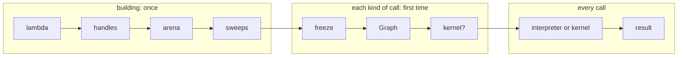
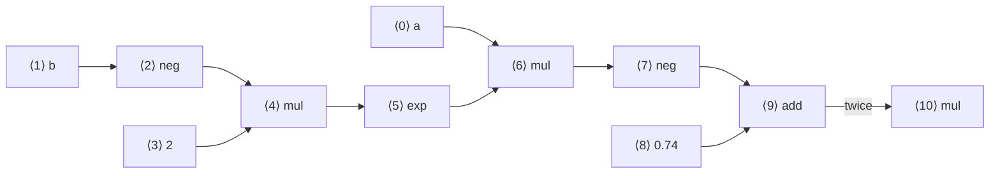
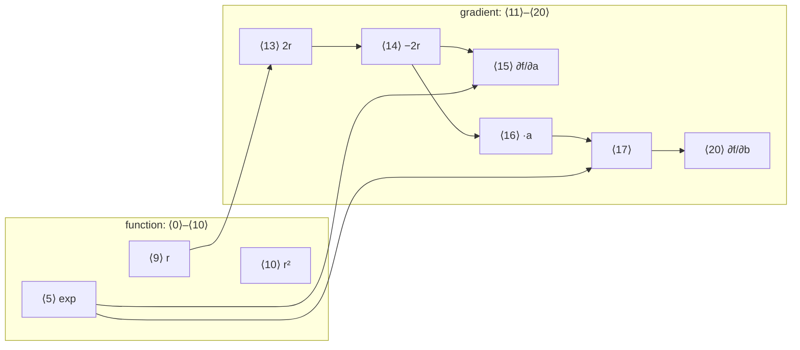

# 1. The architecture

Part I described what ddx does from the outside: you write a lambda, you get
an equation, and the equation answers calls. Part II opens the box. It is
written for someone who will read and change the code: a C++ programmer who
knows calculus but is not a specialist in automatic differentiation or in
compilers. Every term from those fields is explained in words where it first
appears.

This chapter is the map. It names the half-dozen pieces the library is built
from, follows one equation through them, and fixes the conventions the later
chapters use. Each later chapter takes one piece of this map and explains it
in full.

## How to read the code excerpts

Most of the engine is written as ***class templates***: classes with a type
parameter, such as `Arena<T>`, where `T` is the number type (`double` or
`float`). Templates make the code general and the excerpts harder to read. So
every templated excerpt in Part II is shown twice:

1. **the real code**, copied from the tree, with its file and line on the first
   line (`// rt/arena.hpp:222`), trimmed where `// ...` says so;
2. **with `T = double`**: the same code with every template parameter replaced
   by a concrete type and every `auto` spelled out. Its names carry a
   `_double` suffix (`Arena_double`) to show they are not real names in the
   source.

The second form is not made up. libddx contains ***explicit instantiations***
of the engine for `double` and for `float` (`src/rt/instances.cpp`): the
compiler is told to generate those two versions of every class once, inside
the library, instead of in every program that includes the headers. So the
`_double` code is, line for line, what runs when you use an
`rt::Equation<double>`.

## One example, all the way through

Part II follows one equation throughout, the residual of a single data point
from the Quick Look's decay fit:

```cpp
const auto eq = rt::equation([] {
  const auto a = rt::var("a");
  const auto b = rt::var("b");
  const auto r = 0.74 - a * exp(-b * 2.0);
  return r * r;
});
*eq.evaluate(2.0, 0.5);  // 1.7987078981495368e-05
*eq.gradient(2.0, 0.5);  // [-0.0031204399872838437, 0.012481759949135375]
```

Mathematically it is $f(a, b) = (0.74 - a\,e^{-2b})^2$. When a mechanism can't
be shown with this equation (a `select`, a vector, an extern function), the
chapter uses a small ***side model***, marked as such.

Every table of internal state in Part II is printed by a ***probe***: a small
program in `doc/design/probes/` that builds the example against the source
tree and prints what it finds. Nothing is worked out by hand.

## The pieces

The library is built from six pieces. Here they are in the order an equation
meets them.

**The graph.** When the lambda runs, `a * exp(-b * 2.0)` does no arithmetic.
Each operator records *what* to compute: "multiply this by that". Each
recorded operation is a ***node***. A node names its operation and its
operands, the earlier nodes it reads. Together the nodes form a ***graph***:
a network of operations with arrows from each operation to the ones that use
its result. A spreadsheet is a good picture of it: each cell holds a formula
that refers to other cells.

**The arena.** The nodes are stored in one growable array owned by one
object, the ***arena***, class `Arena<T>`. A node's ***node id***
(`NodeId`, a 32-bit unsigned integer) is its index in that array. Nodes refer
to their operands by id, never by pointer. So the whole graph can be copied,
hashed or grown without anything dangling. "Arena" is the general name for
this way of managing memory: many small objects in one buffer, with one owner,
freed together.

**The handle.** `rt::Expression<T>`, the type `rt::var` returns, is not a
node. It is a ***handle***: a small value holding a pointer to the arena and
the id of one node in it. Handles are cheap to copy. Arithmetic on handles
adds nodes to the arena and returns handles to the new nodes.

**The derivative sweeps.** A derivative is computed *as more graph*. A
***derivative sweep*** walks the existing nodes and appends new ones that
compute the derivative. A ***reverse*** sweep walks from the output back
towards the inputs. It produces all the partial derivatives of one output
with respect to every input in a single pass, which makes it the right way to
get a gradient. A ***forward*** sweep walks from the inputs towards the
output. It produces how every node changes along one chosen direction.
Chapters 5 and 6 explain both. Since the derivatives are ordinary nodes, the
same machinery that evaluates $f$ also evaluates $\nabla f$, and the second
derivative is a sweep over the first.

**The freeze.** The arena holds everything ever built: the function, its
Jacobian, and perhaps a Hessian. A given call needs only part of it. The
***freeze*** extracts the part a call needs into a compact, read-only form,
the ***frozen graph***, class `Graph<T>`. The freeze decides the order the
nodes will be computed in, the ***schedule***, and where each intermediate
value will be stored while a call runs, the ***tape***. The tape is a scratch
array of numbers, one slot per value still needed, reused as values die.

**Running.** A frozen graph is executed in one of two ways. The
***interpreter*** walks the schedule one step at a time, reading and writing
the tape. A ***kernel*** is the frozen graph translated to machine code by
LLVM, which is a compiler library. The ***pipeline*** for one kind of call is
the frozen graph together with its kernel, if there is one. It is built the
first time that kind of call is made and kept for later calls.

**The core.** `Core<T>` is the class behind every equation. It owns the
arena, remembers which nodes are the outputs (the ***roots***), runs the
derivative sweeps when they are first needed, holds one pipeline per kind of
call, and checks every call's arguments. `rt::Equation` and `rt::System` are
thin classes on top of it.



## The example, node by node

This is the arena after the lambda has run, as printed by
`doc/design/probes/architecture.cpp`. Each node has an id, an operation, and the ids of its operands. Drawn as a picture, with an arrow from each operand to the
node that reads it, the same eleven nodes are:



And this is how the arena stores them: one array, one entry per node, operands
given by index.

| id | 0 | 1 | 2 | 3 | 4 | 5 | 6 | 7 | 8 | 9 | 10 |
|---|---|---|---|---|---|---|---|---|---|---|---|
| **op** | `var` | `var` | `neg` | `constant` | `mul` | `exp` | `mul` | `neg` | `constant` | `add` | `mul` |
| **reads** | | | 1 | | 2, 3 | 4 | 0, 5 | 6 | | 7, 8 | 9, 9 |
| **means** | $a$ | $b$ | $-b$ | $2$ | $-2b$ | $e^{-2b}$ | $a e^{-2b}$ | $-a e^{-2b}$ | $0.74$ | $r$ | $r^2$ |

**This array is the arena, not the tape.** It holds *formulas*: each row says
what to compute from which rows, and holds no numbers except constants. It is
built once and only ever grows. The tape, introduced in chapter 7, is a
different and much shorter array of *numbers*: the values computed during one
call, with a slot reused as soon as its value is no longer needed.

Three things are worth noticing now. Later chapters explain each one.

- **Operands always have smaller ids.** A node can only read nodes built
  before it. So computing the nodes in id order always has every operand ready
  in time.
- **`0.74 - x` became `add(neg(x), 0.74)`.** The arena stores subtraction as
  adding a negation, so there are fewer operations to differentiate.
- **`r * r` is `mul <9> <9>`.** `r` was built once and is read twice. The arena
  never stores the same computation twice (chapter 3).

The Core's constructor then runs the one sweep that every equation needs,
the reverse sweep for the Jacobian, which appends:

| id | 11 | 12 | 13 | 14 | 15 | 16 | 17 | 18 | 19 | 20 |
|---|---|---|---|---|---|---|---|---|---|---|
| **op** | `constant` | `constant` | `add` | `neg` | `mul` | `mul` | `mul` | `mul` | `mul` | `neg` |
| **reads** | | | 9, 9 | 13 | 5, 14 | 0, 14 | 5, 16 | 3, 17 | 2, 17 | 18 |
| **means** | $0$ | $1$ | $2r$ | $-2r$ | $\partial f/\partial a$ | $-2ra$ | $-2ra\,e^{-2b}$ | $-4ra\,e^{-2b}$ | unused (see ch. 5) | $\partial f/\partial b$ |

The new rows go on the end of the same array. The arena now holds the
function and its gradient side by side:



The value of $f$ is node 10. $\partial f/\partial a$ is node 15 and
$\partial f/\partial b$ is node 20. These are ordinary nodes, made of the same
operations as the function, and they reuse the function's own nodes: node 15
reads node 5, which is $e^{-2b}$, computed once for both.

## The path of a call

Here is what happens, in order, between `rt::equation(lambda)` and the number
`eq.gradient(2.0, 0.5)` returns. Each step names the function that does it.

**Building.** `rt::equation` is a function template:

```cpp
// rt/equation.hpp:170
template <impl::Numeric T = double>
[[nodiscard]] auto equation(std::invocable auto &&assemble) {
  auto [arena, built] = detail::assemble<T>(DDX_FWD(assemble));
  return detail::over<T>(
      built, [&]<typename Eq>(std::type_identity<Eq>, auto... roots) {
        return detail::Creating::create<Eq>(std::move(arena), roots...);
      });
}
```

With `T = double`, and the lambda's type written `Lambda`:

```cpp
Equation_double equation(Lambda &&assemble) {
  // 1. Make an arena, run the lambda with it as "the current arena",
  //    and keep both the arena and whatever the lambda returned.
  auto [arena, built] = assemble_double(assemble);   // unique_ptr<Arena_double>, Expression_double
  // 2. Choose the equation type from what came back (one expression,
  //    an array of them, or a vector), and construct it.
  return Equation_double::create(std::move(arena), built);
}
```

`detail::assemble` is short enough to show whole, with its `T = double` form
beside it:

<table><tr><th>real code</th><th>with <code>T = double</code></th></tr><tr><td>

```cpp
// rt/core.hpp:1569
template <impl::Numeric T>
[[nodiscard]] auto
assemble(std::invocable auto &&assemble) {
  auto arena = std::make_unique<Arena<T>>();
  auto built = [&] {
    const auto scope = scoped_arena(*arena);
    return std::invoke(DDX_FWD(assemble));
  }();
  return std::pair{std::move(arena),
                   std::move(built)};
}
```

</td><td>

```cpp
std::pair<std::unique_ptr<Arena_double>,
          Expression_double>
assemble_double(Lambda &assemble) {
  auto arena = std::make_unique<Arena_double>();
  Expression_double built;
  {
    // rt::var("a") finds *arena while
    // `scope` lives; then it is restored.
    const auto scope = scoped_arena(*arena);
    built = assemble();  // the user's lambda
  }
  return {std::move(arena), built};
}
```

</td></tr></table>

`scoped_arena` is how `rt::var("a")` knows which arena to add to without an
argument. Chapter 3 shows how it works. The arena is a heap object behind a
`std::unique_ptr` so that the handles' pointers to it stay valid when the
equation is moved.

**Constructing.** The equation's constructor, inherited from `Core`, checks
for errors left behind by the lambda: an implicit input with no residual, or
an output that is a vector. Then it runs the reverse sweep for the Jacobian,
the only sweep that runs eagerly. Every other sweep runs the first time a
call needs it. Nothing is frozen yet.

**Calling.** `eq.gradient(2.0, 0.5)`:

1. `point()` turns the arguments into one value per input, or an error
   (chapter 9).
2. The call names what it wants with a `Want` value, here `Want::Gradient`.
3. `Core` asks the pipeline for that `Want` for its frozen graph. The first
   time, the pipeline calls `Core::frozen_for`, which picks the nodes this
   `Want` needs (here, only nodes 15 and 20 and what they read) and calls
   `Graph<T>::freeze` (chapter 7). If compiling is on, the pipeline also has
   LLVM build the kernel (chapter 8). The result is kept.
4. `Core::run` calls the kernel if there is one, and otherwise the
   interpreter, which writes the two partial derivatives into the caller's
   output.

Every later call of the same kind starts at step 4 with the kept pipeline.

## The order of Part II

The chapters follow the path above:

| Chapter | Explains |
|---|---|
| 2. Nodes and the operation table | what a node holds, and the table that lists every operation |
| 3. From a lambda to nodes | handles, the current arena, and how the arena avoids building anything twice |
| 4. Inputs | symbols, parameters, implicit inputs, extern functions as nodes |
| 5. The reverse sweep | how a gradient is appended to the graph |
| 6. Forward sweeps and second order | directions, Hessians, and products with a vector |
| 7. Freezing | from the arena to a schedule and a tape |
| 8. Running | the interpreter, pipelines, and where compiled kernels plug in |
| 9. The equation | `Core`: checking calls, building lazily, and threads |
| 10. Vectors and matrices | how vector nodes fit into all of the above |
| 11. The other front doors | text, dual numbers, and Python |

## Where in the code

| Symbol | File |
|---|---|
| `rt::equation` | `include/rt/equation.hpp:170` |
| `detail::assemble` | `include/rt/core.hpp:1569` |
| `Arena<T>` | `include/rt/arena.hpp` |
| `Expression<T>` | `include/rt/expressions.hpp:75` |
| `Graph<T>` | `include/rt/graph.hpp:187` |
| `Pipeline<T>` | `include/rt/pipeline.hpp:53` |
| `Core<T>` | `include/rt/core.hpp:272` |
| the explicit instantiations | `src/rt/instances.cpp` |

The next chapter starts with the smallest piece: a single node, and the table
of operations every part of the library reads.
